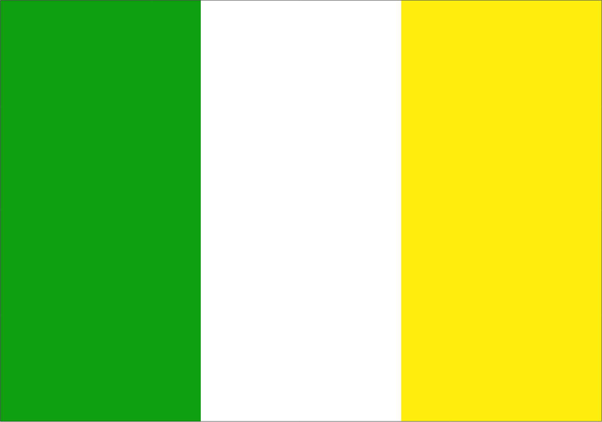

Hije

<h1 align="center">Hije</h1>

  

Informações gerais

Esta página apresenta uma visão geral de Hije, com links para páginas específicas sobre o país.

- Continente: [Gigania](../Geografia/gigania.md)
- População: 49,4 milhões de habitantes

Geografia

Informações sobre o território, as regiões e as cidades de Hije.

- [Geografia de Hije](Hije/Geografia.md)

História

Resumo da história do país e dos principais acontecimentos.

- [História de Hije](Hije/História.md)

Futebol

Informações sobre o futebol nacional, incluindo clubes, ligas e competições.

- [Futebol de Hije](Hije/futebol.md)
- [Federação Hijotana](Hije/Futebol/federacaohijotana.md)
- [Seleção Nacional](Hije/Futebol/hijefc.md)

Outros assuntos

Outras páginas poderão ser adicionadas conforme a enciclopédia crescer.

---

Página em desenvolvimento.
