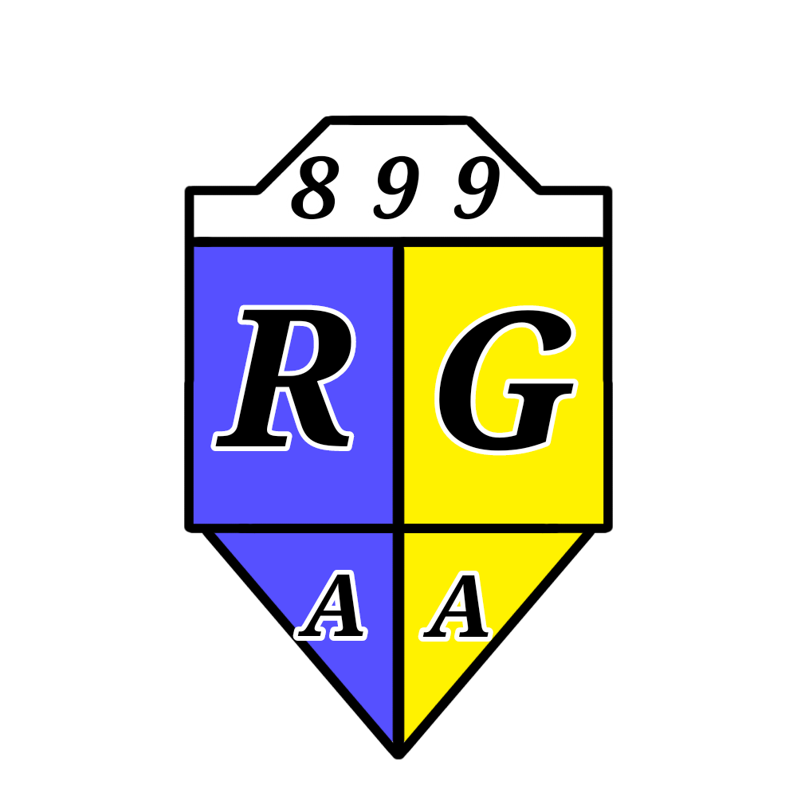

Associação Atlética Rio Grande

  

A Associação Atlética Rio Grande é um dos clubes mais tradicionais de Hije, sediado no bairro de Rio Grande, na cidade de Ettynia. Conhecido por sua história centenária, suas conquistas nacionais e a fidelidade de sua torcida, o clube é uma das principais instituições do futebol hijotano.

Apesar de possuir a quarta maior torcida do país, o Rio Grande foi considerado até 960 o sétimo maior clube de Hije. Sua trajetória é marcada por títulos importantes, períodos de dificuldades esportivas e uma relação histórica com seus torcedores.

Informações gerais

- Nome completo: Associação Atlética Rio Grande
- Fundação informal: 895
- Registro oficial: 897
- Ano presente no escudo: 899
- Cidade: Ettynia, Hije
- Bairro de origem: Rio Grande
- Cores principais: Amarelo e azul
- Estádio: Estádio das Mangueiras
- Capacidade oficial: 38.000 espectadores
- Maior torcida: Quarta maior de Hije

História

Fundação e primeiros anos

O Rio Grande surgiu informalmente em 895, no bairro de Rio Grande, em Ettynia. Sua fundação foi organizada por uma população que não pertencia à elite econômica, mas também não vivia na pobreza extrema. O clube nasceu como uma instituição ligada à comunidade local e, com o tempo, tornou-se um dos símbolos esportivos da cidade.

Seu registro oficial aconteceu em 897. Entretanto, o ano de 899 aparece em seu escudo, pois representa o momento em que os três principais clubes de Ettynia passaram a ser oficialmente reconhecidos: Vitória, em 890; Rio Grande, em 897; e Desportiva Ettynia Hije, em 899.

Antes da consolidação do futebol profissional, o clube conquistou o Campeonato Sulista de 896, considerado um título pré-histórico em sua trajetória.

Primeiras conquistas e rebaixamentos

Em 902, quando o campeonato hijotano passou a contar com rebaixamentos, o Rio Grande e o Hijotano foram os primeiros clubes a experimentar essa nova realidade.

Em 904, o Rio Grande quase voltou a ser rebaixado, mas terminou à frente de seu rival Vitória, que teve uma campanha pior.

A conquista da Primeira Liga Hije em 905 marcou um dos primeiros grandes momentos da história do clube. Entretanto, as temporadas seguintes voltaram a ser difíceis. Depois de quase cair em 906 e 907, o Rio Grande foi rebaixado em 908.

O clube retornou à primeira divisão em 911, mas teve outra campanha complicada. Em 912, terminou na última posição, com apenas 12 pontos em 22 partidas, sofrendo seu segundo rebaixamento.

O retorno definitivo à elite aconteceu em 916. Desde então, o Rio Grande permaneceu na Primeira Liga Hije até os dias atuais.

Consolidação entre os grandes

A conquista da liga em 917 marcou a recuperação esportiva do Rio Grande. No ano seguinte, o clube alcançou um dos maiores feitos de sua história ao vencer a Taça da Dinastia de 918, consolidando sua presença entre as principais instituições do futebol hijotano.

Novos títulos da Primeira Liga Hije vieram em 921 e 938, enquanto as conquistas da Copa Hije em 930 e 942 ampliaram a coleção de troféus do clube.

Apesar dos títulos, o Rio Grande também acumulou temporadas em que esteve muito próximo de novas conquistas nacionais. Os vice-campeonatos e terceiros lugares demonstraram que, em diferentes momentos, o clube esteve perto de disputar o protagonismo da liga.

Dificuldades e ameaças de rebaixamento

Depois de anos competitivos, o Rio Grande enfrentou uma fase preocupante no início da década de 950.

Em 950, o clube terminou como vice-campeão, com 81 pontos, apenas dois atrás do Hijotano, que somou 83. Três anos depois, em 953, a equipe caiu para a 14ª posição, com 33 pontos. O 16º colocado, que foi rebaixado, terminou com 29 pontos.

Em 954, o Rio Grande terminou em 12º lugar, com 38 pontos, enquanto o 16º colocado somou 34. Apesar de escapar novamente, o clube passou duas temporadas consecutivas sob a ameaça de rebaixamento.

A partir de 955, os sustos diminuíram, mas o período permaneceu como uma lembrança importante de que até mesmo um clube tradicional poderia se aproximar da zona de queda.

Retorno ao meio da tabela

A partir de 955, o Rio Grande passou a ocupar posições intermediárias com maior frequência.

Temporada| Posição na Primeira Liga Hije
|---|---:|
955| 5º
956| 5º
957| 9º
958| 9º
959| 6º
960| 7º
961| 7º
962| 7º
963| 9º
964| 9º

Esse período representa uma fase de estabilidade relativa, na qual o Rio Grande deixou para trás os riscos imediatos de rebaixamento, embora sem voltar a disputar regularmente o título da liga.

Títulos

Principais títulos

- Taça da Dinastia: 918
- Primeira Liga Hije: 905, 917, 921 e 938
- Copa Hije: 930, 942 e 961
- Copa Hijotania: 957

Título pré-histórico

- Campeonato Sulista: 896

Campanhas marcantes

Além de suas conquistas, o Rio Grande acumulou campanhas que ficaram marcadas pela proximidade de novos títulos.

Temporada| Resultado| Observação
|---|---:|---:|
916| Vice-campeão| Terminou dois pontos atrás do Hijotano
925| Vice-campeão| Ficou sete pontos atrás da Desportiva
936| 3º lugar| Terminou apenas três pontos atrás do campeão
942| Vice-campeão| Perdeu o título por um ponto para o Atlético Liberdade
947| Vice-campeão| Ficou dois pontos atrás da Desportiva
948| Vice-campeão| Empatou em 76 pontos com o Hijotano, mas perdeu no saldo
950| Vice-campeão| Fez 81 pontos, dois a menos que o Hijotano

Essas campanhas demonstram que o Rio Grande esteve próximo de conquistar mais títulos em diferentes épocas, inclusive em temporadas nas quais apresentou pontuações elevadas.

Estádio

Estádio das Mangueiras

O Estádio das Mangueiras é a casa do Rio Grande e possui capacidade oficial para 38.000 espectadores. Entre os estádios dos três grandes clubes de Ettynia, é considerado o menos moderno.

Quando foi inaugurado, possuía capacidade para 58.000 pessoas. Com o passar do tempo, mudanças nas leis de segurança reduziram sua capacidade oficial para 38.000 lugares. Em grandes jogos, entretanto, o estádio pode receber até 42.000 pessoas.

O Estádio das Mangueiras foi o maior estádio de Hije entre 905 e 932. Posteriormente, a modernização e a expansão de outros estádios fizeram com que perdesse essa posição.

Apesar de já não possuir a maior capacidade do país, continua sendo um dos símbolos históricos do futebol de Ettynia.

Torcida

Barreira Amarela

A torcida do Rio Grande é conhecida como Barreira Amarela. Apesar de ser a quarta maior torcida de Hije, é considerada a mais fanática do país.

A Barreira Amarela é reconhecida por apoiar o clube tanto nos períodos de sucesso quanto nas fases de dificuldades esportivas. O estádio costuma receber grandes públicos, e a torcida mantém uma presença marcante mesmo quando a equipe não disputa os principais títulos.

Os mosaicos organizados pelos torcedores também são conhecidos por sua grandiosidade e criatividade, sendo frequentemente considerados entre os mais impressionantes do futebol hijotano.

A relação entre o clube e sua torcida é uma das características mais importantes de sua identidade. Os rebaixamentos, as campanhas decepcionantes e os períodos sem títulos não apagaram o apoio dos torcedores.

Ídolos

Lindomar Freire

- Posição: Zagueiro
- Nascimento: 888
- Naturalidade: Ettynia, Hije
- Clube: Rio Grande
- Número histórico: 55

Lindomar Freire é considerado um dos primeiros grandes ídolos do futebol hijotano. Nascido em Ettynia, começou sua trajetória nas categorias de base do Rio Grande e estreou profissionalmente em 905, aos 17 anos.

Durante sua carreira, acompanhou os altos e baixos do clube, incluindo os rebaixamentos de 908 e 912. Mesmo assim, permaneceu no Rio Grande e conquistou o respeito da torcida por sua fidelidade e dedicação.

Seu auge aconteceu entre 916 e 921, período em que se destacou como um zagueiro de alto nível, reconhecido por sua experiência, liderança e consistência defensiva.

Conquistas

- Primeira Liga Hije: 905, 917 e 921
- Taça da Dinastia: 918
- Vice-campeonatos da Primeira Liga Hije: 916 e 925

Legado

Lindomar utilizou a camisa 55 durante toda a carreira e nunca mudou de número, mesmo diante de pedidos para fazê-lo. Com o tempo, a camisa 55 tornou-se um símbolo de respeito e tradição entre os defensores do Rio Grande.

Sua permanência no clube durante os períodos mais difíceis consolidou sua imagem como um exemplo de fidelidade.

Lindomar aposentou-se em 926, encerrando sua carreira como uma das maiores lendas da história do Rio Grande.

George Oros

- Posições: Volante e meio-campista
- Nascimento: 890
- Naturalidade: Yutania, Hije

George Oros é considerado um dos maiores jogadores hijotanos da história e consolidou sua reputação durante sua passagem pelo Rio Grande.

Nascido em 890, em Yutania, cresceu em uma família pobre, em uma época na qual a capital ainda possuía uma estrutura urbana muito mais simples, com ruas de terra. Durante a infância, sua principal diversão era jogar bola, utilizando qualquer objeto que pudesse chutar.

Estreou profissionalmente aos 18 anos, em 908, pelo Vila Norte. Posteriormente, passou pelo Yutania City, onde conquistou alguns títulos.

Em 915, quando o Rio Grande disputava a segunda divisão, George Oros decidiu se transferir para o clube, mesmo já sendo considerado um jogador de alto nível.

A decisão se mostrou fundamental para sua trajetória. Em 917, conquistou a Primeira Liga Hije pelo Rio Grande.

O ano de 918 foi o auge de sua carreira. Além de conquistar a Taça da Dinastia, recebeu o prêmio de Melhor Jogador da competição e a distinção de jogador de linha com mais defesas. Naquele mesmo ano, também foi eleito Melhor Jogador de Gigania, tornando-se, até 951, o único volante a conquistar esse prêmio.

Em 921, venceu novamente a Primeira Liga Hije e encerrou a carreira aos 31 anos.

Prêmios individuais

- Melhor Jogador da Dinastia: 913
- Melhor Jogador da Dinastia: 918
- Jogador de linha com mais defesas: 918
- Melhor Jogador de Gigania: 918

Legado

George Oros é lembrado por sua qualidade técnica, capacidade defensiva e importância nas conquistas do Rio Grande. Sua atuação na Taça da Dinastia de 918 é considerada o ponto alto de sua trajetória e uma das grandes atuações individuais da história do clube.

Outros jogadores marcantes

- Tonyfiz Fo Arun: nome associado à história do clube. Informações adicionais sobre sua trajetória poderão ser incluídas nesta seção.

Rivalidades

Rivalidades de Ettynia

Desportiva Ettynia Hije — Clássico da Eternidade

A maior rivalidade do Rio Grande é contra a Desportiva Ettynia Hije. O confronto é conhecido como Clássico da Eternidade.

O nome homenageia a história de dois torcedores, um de cada clube, que eram grandes amigos e costumavam acompanhar os jogos das duas equipes. Durante uma briga entre torcidas em um clássico, ambos morreram por estarem no meio do conflito.

Em memória dos dois amigos, o confronto recebeu o nome de Clássico da Eternidade, representando a permanência da amizade para além da rivalidade esportiva.

Vitória — Clássico Pioneiro

O confronto entre Rio Grande e Vitória é conhecido como Clássico Pioneiro.

O nome faz referência ao fato de ambos serem os dois primeiros clubes a se profissionalizar em Ettynia, sendo instituições fundamentais para a formação da tradição futebolística da cidade.

Rivalidades nacionais

Xitan City — Clássico Oitavo

O confronto entre Rio Grande e Xitan City é conhecido como Clássico Oitavo.

Historicamente, a partida não possuía um nome oficial. Com os títulos conquistados pelo Xitan City e o período sem conquistas do Rio Grande, os dois clubes passaram a ser comparados na disputa pelo posto de oitavo maior clube de Hije.

A imprensa esportiva brincou que o derrotado em um confronto entre as equipes seria considerado o oitavo maior do país. A expressão popularizou-se e deu origem ao nome.

O Rio Grande rejeita a denominação, enquanto o Xitan City, tradicionalmente considerado o oitavo maior clube de Hije, não gosta particularmente do nome, mas o aceita.

Hijotano — Clássico de Multidões

O confronto entre Rio Grande e Hijotano é conhecido como Clássico de Multidões.

A denominação faz referência ao tamanho das torcidas: o Hijotano possui a segunda maior torcida de Hije, enquanto o Rio Grande possui a quarta maior.

Palnor Club — Clássico Sulino

O confronto entre Rio Grande e Palnor Club é conhecido como Clássico Sulino, uma rivalidade que integra o conjunto de confrontos tradicionais do futebol hijotano.

Legado

A Associação Atlética Rio Grande ocupa um lugar importante na história do futebol de Hije. Sua trajetória reúne títulos nacionais e internacionais, campanhas que terminaram por poucos pontos, períodos de rebaixamento e uma recuperação que permitiu ao clube permanecer por décadas entre os participantes da Primeira Liga Hije.

Sua quarta maior torcida, a fidelidade da Barreira Amarela, a tradição do Estádio das Mangueiras e os ídolos que marcaram diferentes gerações fazem do Rio Grande uma das instituições mais reconhecidas do futebol hijotano.

Mais do que os títulos conquistados, o clube construiu sua identidade por meio da ligação com sua comunidade e da permanência de sua torcida mesmo nos momentos mais difíceis.

---

Página em desenvolvimento.
