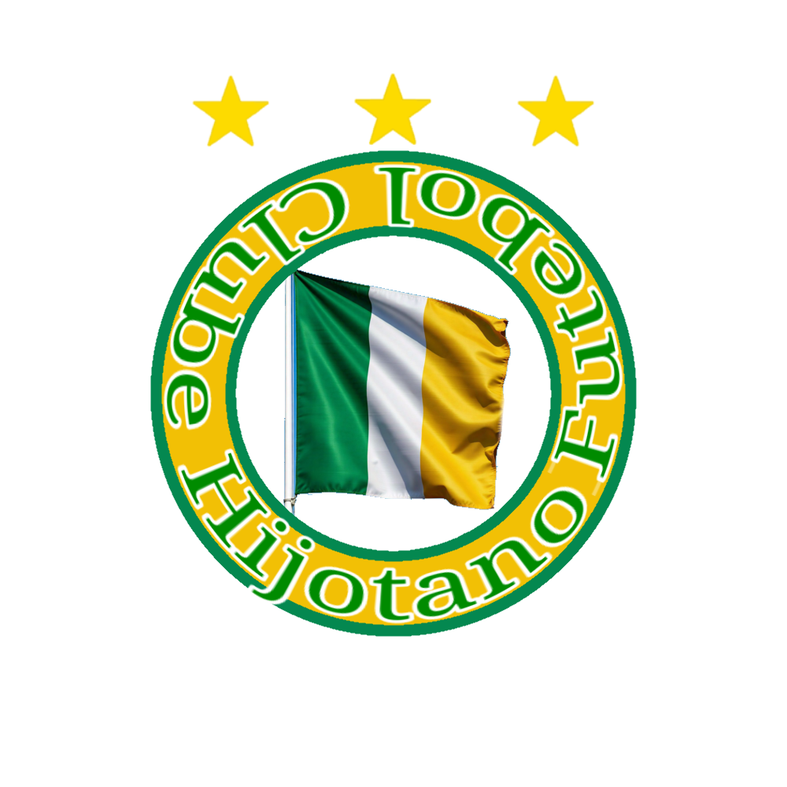

Futebol Clube Hijotano

<h1 align="center">Hijotano Futebol Clube</h1>

  

O Futebol Clube Hijotano, conhecido simplesmente como Hijotano, é um clube de futebol da cidade de Yutania, capital de Hije. Fundado em 890 sob o nome de Hije FC, o clube é um dos sete grandes do futebol hijotano e possui uma das trajetórias mais tradicionais do país.

Inicialmente, a equipe representava o próprio país de Hije por meio de seu nome e identidade visual. Entretanto, ao longo de sua história, surgiu a proposta de adotar uma identidade que representasse não apenas a nação, mas também o povo hijotano. O projeto de reformulação, que incluía um escudo mais moderno, foi concluído até 938. A partir de 939, o clube passou a aparecer nas tabelas dos campeonatos como Futebol Clube Hijotano.

A mudança de identidade também marcou o surgimento do Novo Hije FC, fundado em 939 e associado à antiga identidade visual do Hije FC.

Informações gerais

- Nome completo: Futebol Clube Hijotano
- Nome popular: Hijotano
- Fundação: 890
- Cidade: Yutania, Hije
- Cores: Amarelo, verde e branco
- Rivalidades: Desportiva Ettynia Hije e Yutania City, entre outras
- Estádio atual: Arena Hije
- Capacidade: 78.000 espectadores
- Principais títulos: [Primeira Liga Hije](../primeiraligahije.md) e [Copa Hije](../copahije.md)

Identidade visual

As cores oficiais do Hijotano são amarelo, verde e branco, fazendo do clube um tricolor. Seu uniforme possui um estilo exótico e bastante particular, considerado difícil de reproduzir devido à combinação visual característica da equipe.

Durante seus primeiros anos, o clube utilizava o nome e o escudo do Hije FC. A reformulação foi motivada pelo desejo de representar especificamente o povo hijotano, em vez de simbolizar apenas a nação. A nova identidade foi definida até 938, passando a ser utilizada oficialmente nas competições a partir de 939.

História

Fundação e primeiros anos

O Hijotano foi fundado em 890, inicialmente como Hije FC. Naquele período, o futebol ainda não contava com a Primeira Liga Hije em seu formato histórico posterior, e a Liga Yutania era uma das competições disputadas pelo clube.

A equipe conquistou seus primeiros títulos oficiais na Liga Yutania, vencendo as edições de 897 e 898. Em 899, participou da primeira edição do campeonato hijotano, iniciando sua trajetória na principal competição nacional.

Os primeiros anos da Liga Hije foram marcados por campanhas irregulares. O clube enfrentou dificuldades nas fases de grupos e chegou a ser rebaixado em 902, após terminar na última posição do Grupo B. Permaneceu na segunda divisão em 903 e conseguiu retornar à primeira divisão em 904.

Em 905, conquistou a última edição da Liga Yutania, encerrando uma fase importante de sua história regional.

A primeira grande dinastia nacional

Em 906, o Hijotano conquistou sua primeira Primeira Liga Hije. O título também foi o primeiro de um clube de Yutania na história da competição.

O sucesso continuou nos dois anos seguintes. A equipe voltou a ser campeã em 907 e 908, tornando-se o primeiro clube a conquistar três títulos consecutivos da Primeira Liga Hije. Essa sequência colocou o Hijotano entre os primeiros grandes protagonistas do futebol nacional.

Em 909, o clube terminou como vice-campeão. Naquele mesmo ano, Gerson Armando, um dos maiores ídolos de sua história, encerrou a carreira.

Consolidação entre os grandes

Depois do tricampeonato, o Hijotano continuou ampliando sua coleção de títulos. Conquistou a liga novamente em 916, 920 e 924, alcançando seis títulos nacionais.

Em 917, estreou na Taça da Dinastia, competição internacional de grande importância no universo futebolístico de Gigania.

Nas décadas seguintes, o clube voltou a conquistar a Primeira Liga Hije em 935, 939, 948, 950 e 954, mantendo-se entre as principais forças do país.

Em 943, venceu pela primeira vez a Copa Hije, adicionando uma nova competição nacional à sua lista de conquistas.

A dobradinha de 967

O ano de 967 foi um dos mais marcantes da história do Hijotano. A equipe conquistou simultaneamente a Primeira Liga Hije e a Copa Hije, alcançando seu décimo segundo título da liga e o segundo título da copa.

A conquista da liga foi especialmente significativa por representar o retorno do clube ao topo nacional após um intervalo de treze anos desde o título de 954.

Em 974, o Hijotano voltou a vencer a Primeira Liga Hije, chegando ao seu décimo terceiro título da competição.

Campanhas internacionais

A Taça da Dinastia também faz parte da história do clube. O Hijotano estreou no torneio em 917 e terminou como vice-campeão nas edições de 971 e 972, ficando perto de conquistar um dos títulos mais importantes do futebol de Gigania.

Títulos

Títulos oficiais

Competição| Títulos| Anos
|---|---:|---:|
Primeira Liga Hije| 13| 906, 907, 908, 916, 920, 924, 935, 939, 948, 950, 954, 967 e 974
Copa Hije| 2| 943 e 967

Títulos pré-históricos

Competição| Títulos| Anos
|---|---:|---:|
Liga Yutania| 3| 897, 898 e 905

Os títulos da Liga Yutania pertencem ao período anterior à consolidação da Primeira Liga Hije e fazem parte da história inicial do clube.

Campanhas de destaque

- 906, 907 e 908: primeiro tricampeonato consecutivo da Primeira Liga Hije.
- 917: estreia na Taça da Dinastia.
- 967: conquista simultânea da Primeira Liga Hije e da Copa Hije.
- 971 e 972: vice-campeão da Taça da Dinastia.

Hino

O hino oficial do Futebol Clube Hijotano chama-se “Hijotano do Coração”. A composição celebra a fundação do clube em 890, sua origem popular em Yutania, a antiga identidade como Hije FC e a posterior mudança de nome para representar o povo hijotano.

A letra também destaca a trajetória de conquistas da equipe, fazendo referência tanto ao título da Liga Yutania de 897 quanto à primeira conquista da Primeira Liga Hije, em 906.

O hino reforça a relação entre o clube e o povo de Hije, apresentando o Hijotano não apenas como uma equipe de futebol, mas como um símbolo de identidade e pertencimento nacional.

Hijotano, Hijotano
Ja nasceste para brilhar 

Hijotano, Hijotano 
Criado para ganhar 

Nos simples bairros de Yutania 
Fundado pelo povão
E nas vitórias da simplicidade 
O hijotano como uma nação 

Hijotano, Hijotano 
Criado pra ser campeão 

Hijotano, Hijotano 
Povo de Hije tem no coração 

Nascido em oitocentos e noventa
Criado como Hije F C
Mas para representar seu povo
Tornou se Hijotano 
O grande campeão 

Hijotano, Hijotano 
Criado pra ser campeão 

Hijotano, Hijotano 
O povo de Hije tem no coração 

Desde oitocentos e noventa e sete
Ou talvez novecentos e seis
O Hijotano campeão da cidade
E nacional pela primeira vez 

Tu és grandes desde os primórdios 
Hijotano do coração 
Não representas apenas um povo
Mas também uma grande nação 

Hijotano, Hijotano 
Criado pra ser campeão 

Hijotano, Hijotano 
O povo de Hije tem no coração.

Estádio

Arena Hije

A Arena Hije é o estádio atual do Hijotano, com capacidade para 78.000 espectadores.

O estádio foi financiado em 940. Antes de sua construção, o clube mandava seus jogos no Estádio Terra do Figo, que atualmente pertence ao Novo Hije FC.

Estádio Terra do Figo

O Estádio Terra do Figo possui capacidade para 35.000 espectadores e passou a pertencer ao Novo Hije FC depois que o clube adquiriu a antiga casa do Hijotano.

Após a compra, o Novo Hije realizou reformas para adaptar o estádio à sua própria estrutura.

Novo Hije FC

O Novo Hije FC foi fundado em 939, após a mudança de identidade do antigo Hije FC para Futebol Clube Hijotano.

Seu escudo apresenta grande semelhança com o antigo emblema utilizado pelo Hijotano antes da reformulação, embora existam pequenas diferenças entre os dois desenhos.

A ligação histórica entre os clubes está relacionada tanto à mudança de identidade do Hijotano quanto à transferência do Estádio Terra do Figo para o Novo Hije.

Ídolos

[Gerson Armando](../Jogadores/gerson-armando.md) — O primeiro tricampeão

Posição: Ponta-direita
Número: 10
Nascimento: 879
Naturalidade: Yutania, Hije
Clube: Hijotano

Gerson Armando é um dos maiores ídolos da história do Hijotano e uma figura fundamental nos primeiros anos da Primeira Liga Hije.

Nascido em Yutania, em 879, realizou sua formação nas categorias de base do clube e estreou profissionalmente em 897, ano em que o Hijotano conquistou a Liga Yutania pela primeira vez. Aquele título foi a primeira conquista oficial da equipe.

Em 898, Gerson e o clube voltaram a vencer a Liga Yutania. Na temporada seguinte, o Hijotano terminou em terceiro lugar na competição regional, mas teve dificuldades na primeira edição da Liga Hije, encerrando a fase de grupos na última posição do Grupo A.

Entre 900 e 904, o clube acumulou vice-campeonatos na Liga Yutania e atravessou momentos difíceis no campeonato nacional. Em 902, terminou na última posição do Grupo B da Liga Hije e sofreu seu primeiro rebaixamento. Permaneceu na segunda divisão em 903 e conseguiu o acesso em 904.

Em 905, Gerson conquistou seu terceiro título da Liga Yutania, na última edição da competição. Naquele mesmo ano, o Hijotano terminou em segundo lugar no Grupo B da Liga Hije, mas foi eliminado nas quartas de final, primeira fase do mata-mata.

A conquista da Primeira Liga Hije

Com o encerramento da Liga Yutania, o Hijotano concentrou sua trajetória na competição nacional. Em 906, conquistou a Primeira Liga Hije, tornando-se o primeiro clube de Yutania a vencer o torneio.

O título foi seguido por novas conquistas em 907 e 908. Com isso, Gerson Armando tornou-se o primeiro jogador a fazer parte de um tricampeonato consecutivo da Primeira Liga Hije, feito que marcou definitivamente sua história no clube.

Em 909, o Hijotano terminou como vice-campeão nacional. Ao fim daquela temporada, Gerson encerrou sua carreira.

Títulos por Gerson Armando

Competição| Anos
Liga Yutania| 897, 898 e 905
Primeira Liga Hije| 906, 907 e 908

Gerson Armando ficou marcado como um dos principais nomes da primeira grande fase vencedora do Hijotano e como protagonista do primeiro tricampeonato consecutivo da história da liga.

Linha do tempo

Ano| Acontecimento
|---|---:|
890| Fundação do clube como Hije FC.
890| Estreia do clube na Liga Yutania.
897| Primeiro título da Liga Yutania.
898| Bicampeonato da Liga Yutania.
899| Participação na primeira edição da Liga Hije.
902| Primeiro rebaixamento da história do clube na Liga Hije.
904| Retorno à primeira divisão.
905| Campeão da última edição da Liga Yutania.
906| Primeiro título da Primeira Liga Hije e primeiro clube de Yutania a conquistar a competição.
907| Bicampeonato da Primeira Liga Hije.
908| Primeiro tricampeonato consecutivo da história da Liga Hije.
909| Vice-campeão da liga; aposentadoria de Gerson Armando.
916| Quarto título da Primeira Liga Hije.
917| Estreia na Taça da Dinastia.
920| Quinto título da Primeira Liga Hije.
924| Sexto título da Primeira Liga Hije.
935| Sétimo título da Primeira Liga Hije.
939| Adoção da identidade Futebol Clube Hijotano; oitavo título da liga.
940| Financiamento da Arena Hije.
943| Primeiro título da Copa Hije.
948| Nono título da Primeira Liga Hije.
950| Décimo título da Primeira Liga Hije.
954| Décimo primeiro título da Primeira Liga Hije.
967| Décimo segundo título da liga e segundo título da Copa Hije, conquistados na mesma temporada.
971| Vice-campeão da Taça da Dinastia.
972| Vice-campeão da Taça da Dinastia.
974| Décimo terceiro título da Primeira Liga Hije.

Legado

O Hijotano ocupa um lugar importante na história do futebol de Hije. Sua trajetória combina títulos conquistados ainda na época da Liga Yutania, o protagonismo nos primeiros anos da Primeira Liga Hije, o pioneirismo do tricampeonato consecutivo e a conquista de títulos nacionais em diferentes períodos.

A mudança de Hije FC para Futebol Clube Hijotano também representa uma etapa importante de sua identidade: o clube deixou de se apresentar apenas como representante da nação e passou a adotar explicitamente o nome de seu povo.

Com treze títulos da Primeira Liga Hije, duas Copas Hije e três conquistas da antiga Liga Yutania, o Hijotano permanece como um dos clubes históricos e tradicionais do país.
