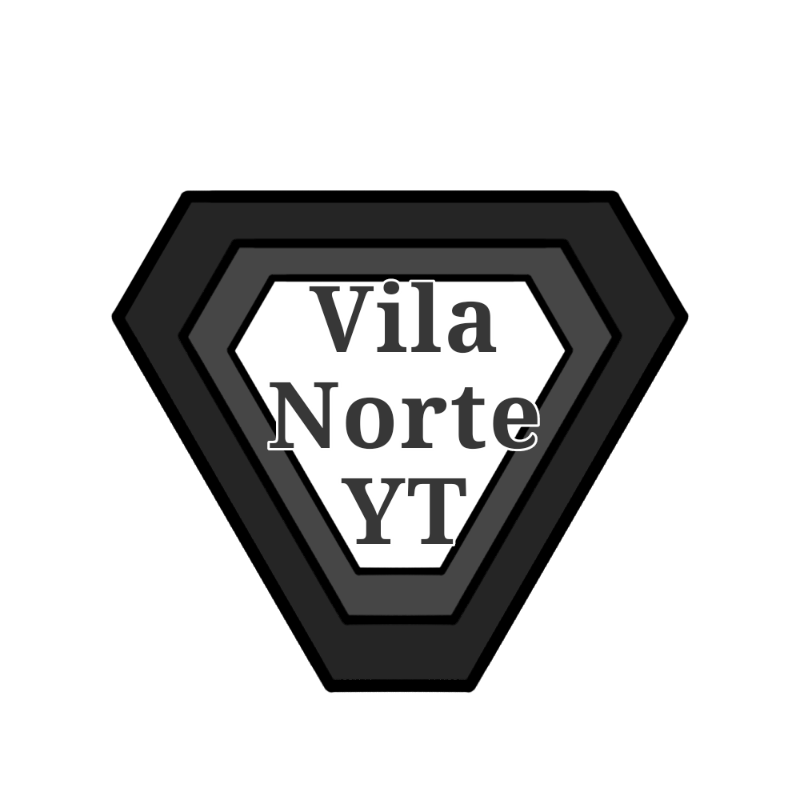

Club Vila Norte de Yutania

<h1 align="center">Escudo do Vila Norte</h1>

  

O Club Vila Norte de Yutania, conhecido simplesmente como Vila Norte, é um clube de futebol hijotano sediado em Yutania, capital de Hije. Fundado em 862 por integrantes da elite do bairro nobre de Vila Norte, o clube possui uma longa história no futebol do país.

Apesar de atualmente estar longe de ser considerado um dos grandes clubes de Hije, o Vila Norte já ocupou uma posição de destaque no futebol nacional. Seu auge aconteceu durante a era das competições regionais, quando dominou a antiga Liga Yutania e conquistou seis títulos.

Na era moderna, o clube conquistou a Copa Hije de 937, mas também ficou marcado pelo elevado número de rebaixamentos na Primeira Divisão hijotana. Mesmo com a perda de protagonismo esportivo, sua história e tradição continuam sendo partes importantes de sua identidade.

Informações gerais

- Nome completo: Club Vila Norte de Yutania
- Nome popular: Vila Norte
- Fundação: 862
- Cidade: Yutania, Hije
- Origem: Bairro nobre de Vila Norte
- Perfil histórico: Clube fundado pela elite
- Torcida: 11ª maior de Hije
- Estádio: Nire de Yutania
- Principal título moderno: Copa Hije de 937

História

Fundação e origem elitista

O Vila Norte foi fundado em 862 por moradores ricos do bairro nobre de Vila Norte, em Yutania. A criação do clube surgiu como uma forma de entretenimento e ocupação do tempo livre para os integrantes da elite local.

Essa origem acompanhou a identidade do clube ao longo de sua história. Diferentemente de equipes associadas às camadas populares, o Vila Norte nasceu em um ambiente privilegiado e manteve essa característica como parte de sua trajetória.

O auge regional

O período mais vitorioso do Vila Norte aconteceu durante a era das competições regionais de Hije. Naquele período, a Liga Yutania era uma das principais competições disputadas pelo clube, e a equipe conseguiu construir uma trajetória de grande sucesso.

O Vila Norte conquistou seis edições da competição, nos anos de 890, 892, 894, 895, 899 e 901, tornando-se o maior campeão da Liga Yutania.

Essas conquistas representam o auge histórico do clube e uma época em que ele era considerado uma das principais forças do futebol hijotano.

Os torcedores, entretanto, não gostam de ver essas conquistas classificadas como títulos pré-históricos, expressão utilizada para se referir aos campeonatos anteriores à era moderna do futebol de Hije. Para eles, esses títulos fazem parte da história legítima do clube e merecem ser tratados com a mesma importância histórica de suas conquistas posteriores.

A participação no campeonato nacional

Com a consolidação do campeonato hijotano, o Vila Norte passou a disputar a competição nacional. Apesar de sua tradição regional, a equipe não conseguiu reproduzir o mesmo domínio no cenário nacional.

Seus melhores resultados na Primeira Liga Hije foram dois quartos lugares, alcançados em 904 e 909. Depois dessas campanhas, o clube nunca mais conseguiu terminar a competição em uma posição tão alta.

A distância entre o passado vitorioso e o desempenho nacional posterior tornou-se uma das principais características da história do Vila Norte.

A conquista da Copa Hije

O principal título moderno do Vila Norte chegou em 937, quando conquistou a Copa Hije.

A vitória representou uma conquista importante para um clube cuja fase de maior domínio havia acontecido décadas antes, durante a era das competições regionais.

Até o momento, esse é o único título moderno do clube informado nesta página.

O recorde de rebaixamentos

O Vila Norte detém um recorde pouco desejado: é o clube com mais rebaixamentos na história do campeonato hijotano.

A equipe caiu para a segunda divisão em 19 temporadas diferentes, atravessando períodos de instabilidade que contrastam com sua antiga condição de potência regional.

Os rebaixamentos aconteceram nos seguintes anos:

905, 910, 914, 920, 925, 931, 936, 938, 940, 944, 947, 949, 952, 955, 957, 963, 965, 971 e 973.

Esse histórico contribuiu para que o Vila Norte perdesse espaço entre os principais clubes de Hije. Atualmente, sua torcida é a 11ª maior do país, e a equipe está distante do protagonismo que marcou sua fase de domínio da Liga Yutania.

Títulos

Títulos oficiais da era moderna

Competição| Títulos| Ano
Copa Hije| 1| 937

Títulos históricos regionais

Competição| Títulos| Anos
Liga Yutania| 6| 890, 892, 894, 895, 899 e 901

A Liga Yutania representa o período de maior sucesso do Vila Norte. Seus seis títulos fizeram do clube o maior campeão da competição e permanecem como parte central de sua identidade histórica.

Estádio

Nire de Yutania

O Nire de Yutania é o estádio do Vila Norte e um dos locais esportivos mais históricos de Hije. Um dos acontecimentos mais importantes associados ao estádio foi a realização do primeiro jogo da seleção hijotana em sua história.

Originalmente, o estádio possuía capacidade para 32.000 espectadores. Na década de 940, mudanças relacionadas à segurança reduziram sua capacidade para 23.326 lugares.

Durante a década de 950, acompanhando a expansão de outros estádios do país, o Vila Norte ampliou novamente o Nire de Yutania, elevando sua capacidade para 34.000 espectadores.

O estádio mantém sua importância histórica mesmo com a perda de protagonismo esportivo do clube.

Ídolos

Armando Bah

Posição: Ponta-esquerda
Número: 10
Nascimento: 870
Naturalidade: Yutania, Hije
Clube: Vila Norte

Armando Bah foi um dos maiores jogadores da era mais antiga do futebol hijotano e um dos principais nomes da história do Vila Norte.

Nascido em 870 no bairro nobre de Vila Norte, em Yutania, cresceu próximo ao clube. Seu irmão mais velho fazia parte do ambiente da equipe, e acompanhá-lo contribuiu para que Armando desenvolvesse seu vínculo com o Vila Norte.

Aos 17 anos, em 887, começou a jogar pelo clube. Seus primeiros anos foram dedicados a competições que atualmente seriam classificadas como amistosas, mas que, naquela época, possuíam grande importância esportiva.

Entre 887 e 889, Armando marcou 20 gols e distribuiu 12 assistências nesses torneios.

A era da Liga Yutania

Em 890, foi disputada a primeira edição da Liga Yutania. Armando Bah conquistou o título com o Vila Norte, iniciando uma trajetória marcada por conquistas regionais e participações decisivas na competição.

A Liga Yutania era disputada em torneios curtos, com aproximadamente seis partidas, o que tornava cada participação especialmente importante. Além dos números registrados na competição, Armando continuava atuando nos torneios da época que hoje seriam considerados amistosos.

Ao longo de sua carreira, participou de todas as seis campanhas vitoriosas do Vila Norte na Liga Yutania: 890, 892, 894, 895, 899 e 901.

Temporadas de Armando Bah

Os números abaixo separam os registros da Liga Yutania dos totais informados quando os torneios da época considerados amistosos também são contabilizados.

Ano| Liga Yutania| Gols e assistências na liga| Números informados incluindo amistosos
887–889| —| —| 20 gols e 12 assistências no período
890| Campeão| 2 gols| 7 gols e 8 assistências
891| Vice-campeão| 1 gol| Nenhum gol ou assistência nos amistosos
892| Campeão| 3 gols e 1 assistência| 10 gols e 4 assistências
893| Vice-campeão| 1 gol e 1 assistência| 9 gols e 2 assistências
894| Campeão| 3 gols e 2 assistências| 3 gols; número de assistências não informado
895| Campeão| 2 gols e 4 assistências| 12 gols e 1 assistência
896| —| 1 gol e 1 assistência| 3 gols e 5 assistências
897| —| 1 gol e 1 assistência| 7 gols e 7 assistências
898| —| 1 gol e 2 assistências| 16 gols e 2 assistências
899| Campeão| 4 gols e 3 assistências| 5 gols e 5 assistências
900| —| 0 gols e 0 assistências| 1 gol; assistências não informadas
901| Campeão| 1 gol; número de assistências não informado| 2 gols e 6 assistências
902| —| 0 gols e 1 assistência| 2 gols e 1 assistência
903| —| 1 gol e 0 assistências| 1 gol e 0 assistências

Em 903, Armando Bah encerrou sua carreira no futebol, deixando como legado uma trajetória ligada ao período mais antigo do Vila Norte e às seis conquistas regionais do clube.

Títulos por Armando Bah

Competição| Anos
Liga Yutania| 890, 892, 894, 895, 899 e 901

Armando Bah é lembrado como um dos principais jogadores da era inicial do futebol de Hije. Sua trajetória está diretamente ligada ao período em que o Vila Norte dominava o cenário regional e construiu a base de sua tradição esportiva.

Rivalidades

O Vila Norte possui rivalidades com outros clubes de Yutania, especialmente:

- Yutania City
- Hijotano
- Sallya fo Arun

Esses confrontos fazem parte do cenário futebolístico da capital hijotana e das relações históricas entre seus clubes.

Legado

O Vila Norte é um exemplo de clube cuja importância histórica supera seu protagonismo esportivo atual. Fundado pela elite de Yutania, construiu sua maior fase de sucesso durante a era das competições regionais, quando conquistou seis títulos da Liga Yutania e se tornou o maior campeão da competição.

Na era moderna, a conquista da Copa Hije de 937 representou um dos poucos grandes momentos de uma trajetória marcada por dificuldades na liga nacional. Seus 19 rebaixamentos contrastam com o passado vitorioso e fazem parte da identidade contemporânea do clube.

Apesar da queda de desempenho, o Vila Norte permanece como uma instituição histórica do futebol hijotano, especialmente por sua participação nos primeiros períodos de organização das competições de Hije.
