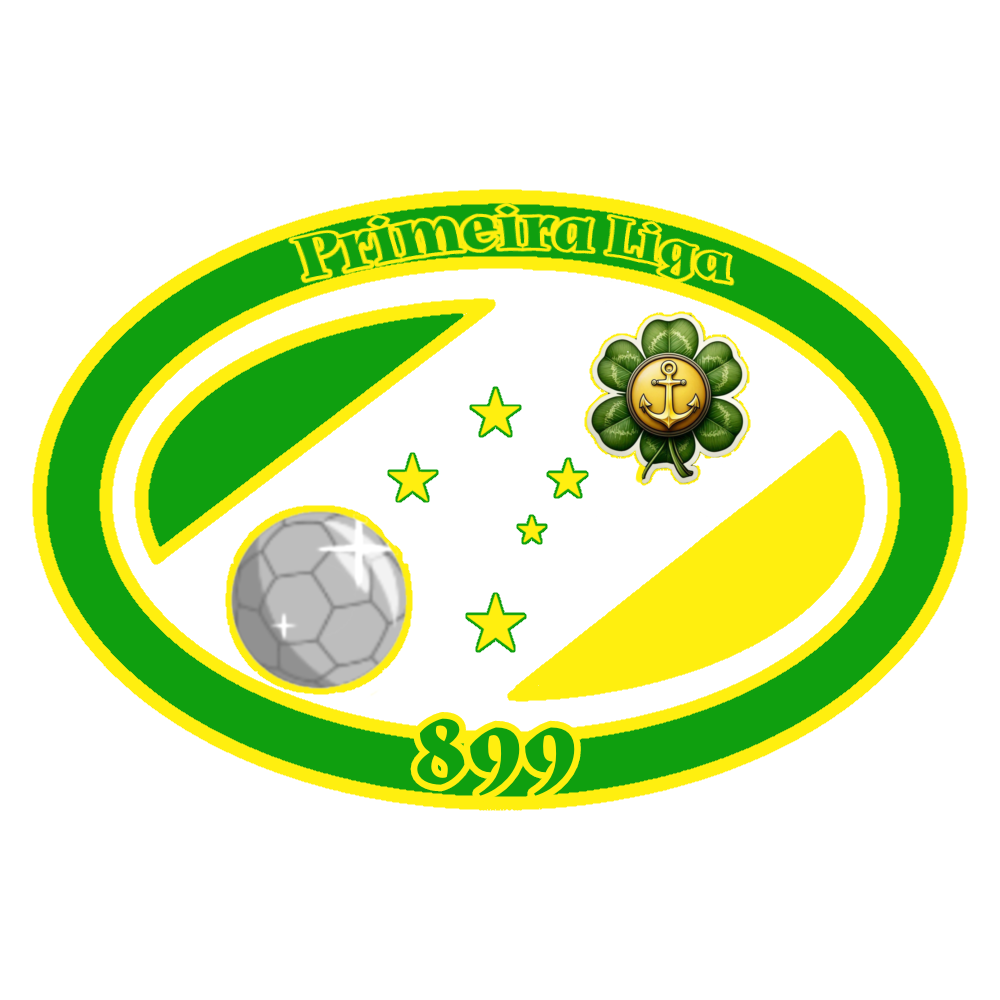

Primeira Liga Hije

Origem

A Primeira Liga Hije nasceu no ano de 899, quando a [FHF](federacaohijotana.md) (Federação Hijotana de Futebol) decidiu criar uma competição que reunisse os clubes mais fortes de todo o país.

Formato histórico

Desde sua criação, em 899, a Primeira Liga Hije passou por diversas mudanças em seu sistema de disputa, no número de participantes e nas regras de rebaixamento.

899 — Formato inicial

Quando foi criada, em 899, a Primeira Liga Hije ainda não seguia o formato tradicional de liga. A competição era dividida em dois grupos, A e B, cada um com quatro clubes.

Os participantes disputavam jogos de ida dentro de seus respectivos grupos. Ao final dessa fase, os dois melhores colocados de cada grupo avançavam para uma fase eliminatória, disputada em formato de mata-mata.

900 — Expansão dos grupos

Em 900, o campeonato manteve o formato da edição anterior, mas passou a contar com cinco clubes em cada grupo, ampliando o número total de participantes.

901 — Ampliação da fase eliminatória

Em 901, os grupos passaram a contar com seis clubes cada. Além disso, os quatro melhores colocados de cada grupo se classificavam para a fase de mata-mata.

902–908 — Introdução do rebaixamento

Em 902, o formato foi mantido, mas uma nova regra foi introduzida: o último colocado de cada grupo passou a ser rebaixado.

Esse sistema permaneceu em vigor até 908.

909–923 — Adoção dos pontos corridos

Em 909, a Primeira Liga Hije adotou pela primeira vez o formato de liga por pontos corridos. A competição passou a contar com 12 clubes, que se enfrentavam em partidas de ida e volta.

Ao final da temporada, os dois últimos colocados eram rebaixados. Esse formato permaneceu até 923.

924–940 — Expansão para 14 clubes

Em 924, o número de participantes aumentou de 12 para 14 clubes. O sistema de pontos corridos, com partidas de ida e volta, foi mantido, assim como o rebaixamento dos dois últimos colocados.

Esse formato durou até 940.

941–944 — Expansão para 16 clubes

Em 941, a liga foi ampliada para 16 participantes. A mudança também veio acompanhada do aumento do número de rebaixados, que passou de dois para três clubes por temporada.

Esse formato foi utilizado até 944.

945–981 — Expansão para 18 clubes

Em 945, a Primeira Liga Hije passou a contar com 18 clubes. O sistema de pontos corridos, com partidas de ida e volta, foi mantido, assim como o rebaixamento de três clubes por temporada.

Esse formato permanece em vigor até a temporada de 981.

Campeões da Primeira Liga Hije

Esta página reúne os campeões de todas as edições da Primeira Liga Hije, desde a fundação da competição, em 899, até a temporada de 981.

Campeões de 899 a 908

Nas primeiras dez edições, o campeonato era decidido por meio de fases de grupos e mata-mata. As finais abaixo registram os resultados das decisões pelo título.

899 — Zinya City

Final: Zinya City 2–1 Yutania City

O Zinya City venceu o Yutania City por 2 a 1 e se tornou o primeiro campeão hijotano.

900 — [Vitória](Clubes/vitoriafutebolclube.md)

- Jogo de ida: Vitória 3–0 Xitan City
- Jogo de volta: Xitan City 2–0 Vitória

Mesmo perdendo a partida de volta por 2 a 0, o Vitória conquistou o título, vencendo o confronto por 3 a 2 no placar agregado.

901 — [Desportiva Ettynia](Clubes/desportivaettyniahije.md)

- Jogo de ida, em Palnor: Palnor Club 1–1 Desportiva Ettynia
- Jogo de volta, em Ettynia: Desportiva Ettynia 2–0 Palnor Club

Após empatar a primeira partida, a Desportiva Ettynia venceu por 2 a 0 em casa e conquistou o título.

902 — [Desportiva Ettynia](Clubes/desportivaettyniahije.md)

- Jogo de ida: Hito 0–1 Desportiva Ettynia
- Jogo de volta: Desportiva Ettynia 1–1 Hito

Placar agregado: Desportiva Ettynia 2–1 Hito.

903 — Zinya City

- Jogo de ida: Hije de Palnor 2–0 Zinya City
- Jogo de volta: Zinya City 5–2 Hije de Palnor

Placar agregado: Zinya City 5–4 Hije de Palnor.

904 — Xitan City

- Jogo de ida: Hije de Palnor 0–1 Xitan City
- Jogo de volta: Xitan City 2–2 Hije de Palnor

Placar agregado: Xitan City 3–2 Hije de Palnor.

905 — [Rio Grande](Clubes/aario-grande.md)

- Jogo de ida: Hito 2–1 Rio Grande
- Jogo de volta: Rio Grande 2–0 Hito

Placar agregado: Rio Grande 3–2 Hito.

906 — [Hijotano](Clubes/fchijotano.md)

- Jogo de ida: Hito 1–2 Hijotano
- Jogo de volta: Hijotano 1–0 Hito

Placar agregado: Hijotano 3–1 Hito.

907 — [Hijotano](Clubes/fchijotano.md)

- Jogo de ida: Hito 2–0 Hijotano
- Jogo de volta: Hijotano 3–0 Hito

Placar agregado: Hijotano 3–2 Hito.

908 — [Hijotano](Clubes/fchijotano.md)

- Jogo de ida: Hijotano 1–0 Hito
- Jogo de volta: Hito 0–0 Hijotano

Placar agregado: Hijotano 1–0 Hito.

Campeões de 909 a 981

A partir de 909, a Primeira Liga Hije passou a ser disputada em pontos corridos. A seguir, estão listados os campeões de cada temporada e suas respectivas pontuações.

Década de 900

- 909: Atlético Liberdade — 42 pontos
- 910: [Vitória](Clubes/vitoriafutebolclube.md) — 39 pontos
- 911: [Desportiva Ettynia](Clubes/desportivaettyniahije.md) — 50 pontos
- 912: Yutania City — 44 pontos
- 913: [Desportiva Ettynia](Clubes/desportivaettyniahije.md) — 49 pontos
- 914: Zinya City — 44 pontos
- 915: [Desportiva Ettynia](Clubes/desportivaettyniahije.md) — 44 pontos
- 916: [Hijotano](Clubes/fchijotano.md) — 44 pontos
- 917: [Rio Grande](Clubes/aario-grande.md) — 54 pontos
- 918: [Desportiva Ettynia](Clubes/desportivaettyniahije.md) — 47 pontos
- 919: Atlético Liberdade — 47 pontos

Década de 920

- 920: [Hijotano](Clubes/fchijotano.md) — 45 pontos
- 921: [Rio Grande](Clubes/aario-grande.md) — 51 pontos
- 922: [Desportiva Ettynia](Clubes/desportivaettyniahije.md) — 48 pontos
- 923: [Desportiva Ettynia](Clubes/desportivaettyniahije.md) — 53 pontos
- 924: [Hijotano](Clubes/fchijotano.md) — 61 pontos
- 925: [Desportiva Ettynia](Clubes/desportivaettyniahije.md) — 54 pontos
- 926: Hije de Palnor — 58 pontos
- 927: Yutania City — 56 pontos
- 928: [Vitória](Clubes/vitoriafutebolclube.md) — 51 pontos
- 929: [Vitória](Clubes/vitoriafutebolclube.md) — 59 pontos

Década de 930

- 930: Xitan City — 54 pontos
- 931: Atlético Liberdade — 56 pontos
- 932: [Vitória](Clubes/vitoriafutebolclube.md) — 56 pontos
- 933: Atlético Liberdade — 52 pontos
- 934: [Desportiva Ettynia](Clubes/desportivaettyniahije.md) — 67 pontos
- 935: [Hijotano](Clubes/fchijotano.md) — 52 pontos
- 936: Rio Newen — 53 pontos
- 937: [Vitória](Clubes/vitoriafutebolclube.md) — 59 pontos
- 938: [Rio Grande](Clubes/aario-grande.md) — 55 pontos
- 939: [Hijotano](Clubes/fchijotano.md) — 66 pontos

Década de 940

- 940: Yutania City — 62 pontos
- 941: Yutania City — 65 pontos
- 942: Atlético Liberdade — 59 pontos
- 943: [Desportiva Ettynia](Clubes/desportivaettyniahije.md) — 75 pontos
- 944: Zinya City — 70 pontos
- 945: Zinya City — 76 pontos
- 946: Zinya City — 74 pontos
- 947: [Desportiva Ettynia](Clubes/desportivaettyniahije.md) — 77 pontos
- 948: [Hijotano](Clubes/fchijotano.md) — 76 pontos
- 949: [Vitória](Clubes/vitoriafutebolclube.md) — 79 pontos

Década de 950

- 950: [Hijotano](Clubes/fchijotano.md) — 83 pontos
- 951: Zinya City — 76 pontos
- 952: Yutania City — 78 pontos
- 953: [Desportiva Ettynia](Clubes/desportivaettyniahije.md) — 86 pontos
- 954: [Hijotano](Clubes/fchijotano.md) — 90 pontos
- 955: Yutania City — 84 pontos
- 956: Yutania City — 79 pontos
- 957: Yutania City — 76 pontos
- 958: Xitan City — 80 pontos
- 959: Zinya City — 84 pontos

Década de 960

- 960: Xitan City — 79 pontos
- 961: Palnor Club — 94 pontos
- 962: Palnor Club — 93 pontos
- 963: Palnor Club — 86 pontos
- 964: Zinya City — 86 pontos
- 965: [Vitória](Clubes/vitoriafutebolclube.md) — 85 pontos
- 966: Palnor Club — 86 pontos
- 967: [Hijotano](Clubes/fchijotano.md) — 76 pontos
- 968: Hito — 74 pontos
- 969: Hito — 67 pontos

Década de 970

- 970: [Desportiva Ettynia](Clubes/desportivaettyniahije.md) — 76 pontos
- 971: Hije de Palnor — 71 pontos
- 972: [Desportiva Ettynia](Clubes/desportivaettyniahije.md) — 77 pontos
- 973: Yutania City — 77 pontos
- 974: [Hijotano](Clubes/fchijotano.md) — 72 pontos
- 975: Hito — 79 pontos
- 976: [Desportiva Ettynia](Clubes/desportivaettyniahije.md) — 76 pontos
- 977: Hije de Palnor — 72 pontos
- 978: [Vitória](Clubes/vitoriafutebolclube.md) — 74 pontos
- 979: Xitan City — 73 pontos

Temporada de 980

- 980: Zinya City — 68 pontos

Temporada de 981

- 981: Rosnari — 76 pontos

Artilheiros por temporada

Registro dos artilheiros das edições em que os dados estão disponíveis.

Rebaixados da Primeira Liga Hije

Temporadas de 902 a 910

- 902: [Rio Grande](Clubes/aario-grande.md) e [Hijotano](Clubes/fchijotano.md)
- 903: Hito e Falcão Norte
- 904: [Vitória](Clubes/vitoriafutebolclube.md) e Univ Hije
- 905: Palnor Club e Vila Norte
- 906: Hije de Palnor e Atl Zinyo
- 907: [Vitória](Clubes/vitoriafutebolclube.md) e Zinya City
- 908: [Rio Grande](aario-grande.md) e Univ Hije
- 909: Hije de Palnor e Esporte Peixoto
- 910: Palnor Club e Vila Norte

Temporadas de 911 a 920

- 911: Hito e Zinya City
- 912: Gen Diamond Yellow e [Rio Grande](aario-grande.md)
- 913: Palnor Club e Univ Hije
- 914: Vista Bella e Vila Norte
- 915: Pedraguaínos e Atl Zinyo
- 916: Rio Newen e Gen Diamond Yellow
- 917: Hito e Falcão Norte
- 918: Gen Diamond Yellow e Esporte Peixoto
- 919: Falcão Norte e Palnor Club
- 920: Vila Norte e Univ Hije

Temporadas de 921 a 930

- 921: Xitan City e Vista Bella
- 922: Atlético Liberdade e Yutania City
- 923: Palnor Club e Univ Hije
- 924: Pedraguaínos e Falcão Norte
- 925: Vista Bella e Vila Norte
- 926: Rio Newen e Esporte Peixoto
- 927: Palnor Club e Vista Bella
- 928: Zinya City e Atl Zinyo
- 929: Esporte Peixoto e Gen Diamond Yellow
- 930: Pedraguaínos e Palnor Club

Temporadas de 931 a 940

- 931: Vila Norte e Vista Bella
- 932: Pedraguaínos e Esporte Peixoto
- 933: Gen Diamond Yellow e Univ Hije
- 934: Atl Zinyo e Palnor Club
- 935: Vista Bella e Pedraguaínos
- 936: Esporte Peixoto e Vila Norte
- 937: Palnor Club e Atlético Liberdade
- 938: Vila Norte e Falcão Norte
- 939: Atl Zinyo e Vista Bella
- 940: Esporte Peixoto e Vila Norte

Temporadas de 941 a 950

- 941: Hito, Palnor Club e Pedraguaínos
- 942: Univ Hije, Atl Zinyo e Esporte Peixoto
- 943: Palnor Club, Vista Bella e Pedraguaínos
- 944: Falcão Norte, Vila Norte e Gen Diamond Yellow
- 945: Palnor Club, Esporte Peixoto e Pedraguaínos
- 946: Rio Newen, Woarshire e Falcão Norte
- 947: Univ Hije, Vila Norte e Esporte Peixoto
- 948: Gen Diamond Yellow, Woarshire e Vista Bella
- 949: Univ Hije, Atl Zinyo e Vila Norte
- 950: Palnor Club, Gen Diamond Yellow e Esporte Peixoto

Temporadas de 951 a 960

- 951: Woarshire, Pedraguaínos e Falcão Norte
- 952: Vila Norte, Gen Diamond Yellow e Vista Bella
- 953: Univ Hije, Falcão Norte e Rio Newen
- 954: SE Ettynia, Woarshire e Vista Bella
- 955: Vila Norte, Gen Diamond Yellow e Rio Newen
- 956: Univ Hije, Pedraguaínos e Woarshire
- 957: Falcão Norte, Vila Norte e Gen Diamond Yellow
- 958: Univ Hije, Rio Newen e Novo Hije
- 959: Gen Diamond Yellow, SE Ettynia e Pedraguaínos
- 960: Woarshire, Vista Bella e Falcão Norte

Temporadas de 961 a 970

- 961: Gen Diamond Yellow, Hije de Palnor e Esporte Peixoto
- 962: Rio Newen, SE Ettynia e Pedraguaínos
- 963: Atl Zinyo, Falcão Norte e Vila Norte
- 964: Esporte Peixoto, Vista Bella e Novo Hije
- 965: Falcão Norte, Vila Norte e Univ Hije
- 966: Gen Diamond Yellow, Novo Hije e Woarshire
- 967: Kotana Town, Univ Hije e Pedraguaínos
- 968: PSC, Univ Hije e Pedraguaínos
- 969: SE Ettynia, Gen Diamond Yellow e Novo Hije
- 970: Zaminia City, Univ Hije e Sallya fo Arun

Temporadas de 971 a 981

- 971: Falcão Norte, Atl Zinyo e Vila Norte
- 972: Univ Hije, Woarshire e Vista Bella
- 973: Falcão Norte, Atl Zinyo e Vila Norte
- 974: Kotana Town, SE Ettynia e Gen Diamond Yellow
- 975: Pedraguaínos, Sallya fo Arun e Esporte Peixoto
- 976: Kotana Town, Falcão Norte e Rio Newen
- 977: Pedraguaínos, SE Ettynia e Woarshire
- 978: Novo Hije, Rio Newen e Falcão Norte
- 979: Vista Bella, Zaminia City e Gen Diamond Yellow
- 980: Esporte Peixoto, SE Ettynia e Pedraguaínos
- 981: Falcão Norte, Univ Hije e Woarshire

Lista dos clubes rebaixados em cada edição.

Recordes e estatísticas

Maiores campeões da Primeira Liga Hije

- 1º — [Desportiva Ettynia](Clubes/desportivaettyniahije.md): 16 títulos
- 2º — [Hijotano](Clubes/fchijotano.md): 13 títulos
- 3º — Zinya City: 10 títulos
- 4º — Yutania City: 9 títulos
- 4º — [Vitória](Clubes/vitoriafutebolclube.md): 9 títulos
- 6º — Xitan City: 5 títulos
- 6º — Atlético Liberdade: 5 títulos
- 8º — [Rio Grande](Clubes/aario-grande.md): 4 títulos
- 8º — Palnor Club: 4 títulos
- 10º — Hije de Palnor: 3 títulos
- 10º — Hito: 3 títulos
- 12º — Rosnari: 1 título
- 12º — Rio Newen: 1 título

Títulos consecutivos

Até a temporada de 981, nenhum clube havia conquistado a Primeira Liga Hije por quatro temporadas consecutivas.

Quatro clubes conseguiram conquistar o título em três temporadas consecutivas:

- [Hijotano](Clubes/fchijotano.md): 906, 907 e 908.
- Zinya City: 944, 945 e 946.
- Yutania City: 955, 956 e 957.
- Palnor Club: 961, 962 e 963.

O recorde de títulos consecutivos da competição permanece, portanto, em três temporadas.

Clubes nunca rebaixados

A [Desportiva Ettynia](Clubes/desportivaettyniahije.md) é o único clube da história da Primeira Liga Hije que nunca foi rebaixado para uma divisão inferior.
